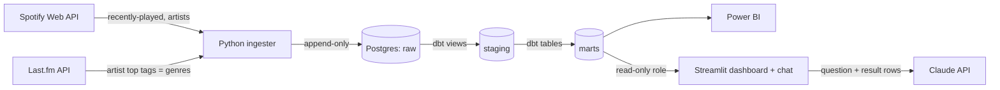

# Spotify listening pipeline

A small data engineering project: pull my own Spotify listening history, model it, and
explore it in a dashboard.



## Stack

| Piece | Role |
|---|---|
| Python (`ingest/`) | OAuth login, polls Spotify and Last.fm, writes raw JSON to Postgres |
| Postgres 16 (Docker) | Warehouse with three schemas: `raw`, `staging`, `marts` |
| dbt (`dbt/`) | Transformations, tests, documentation; rebuilt automatically after each ingestion |
| Power BI Desktop | Dashboard on top of `marts` |
| Streamlit (`app/`) | Second dashboard on `marts`, plus a chat that answers questions with SQL and charts |
| GitHub Actions | Lint, unit tests, `dbt build` on every push |

## Data model

- **`raw`**: what Spotify returned, untouched. `recently_played` is append-only, because the
  API only exposes the last 50 plays, so this table is the only copy of history. `artists`
  keeps the latest Spotify snapshot per artist and `artist_tags` the latest Last.fm tags.
  `ingest_runs` logs each run. `extended_history` holds Spotify's "Extended streaming history"
  export (real `ms_played`, skips, the whole past; the IP address is dropped on load) and
  `tracks` the metadata fetched for those tracks, one Spotify call each.
- **`staging`** (views): flatten the JSON, cast types, compute local time. One model per raw
  entity. Genres are Last.fm tags, lowercased and filtered: tags listed in the `ignored_tags`
  seed (such as "seen live") are dropped, as are tags below a popularity cut, keeping at most
  five per artist (`genre_min_tag_count` and `genre_max_per_artist` in `dbt_project.yml`).
- **`marts`** (tables), a star schema plus ready-made aggregates for the dashboard:
  - `fct_plays`: one row per play, from 2020-01-01. A play is a stream of at least 30 seconds
    (Spotify's own threshold). Plays up to the end of the export come from it, with the real
    time played; later ones come from `recently_played`. The two sources never overlap.
    Plays made in a private session are left out. `listened_ms` is the time to use for hours.
  - `fct_stream_events`: every stream in the export, including skips under 30 seconds, with the
    skipped flag and how each started and ended. For skip analysis.
  - `dim_tracks` (includes the album cover URL), `dim_artists`, `dim_date`.
  - `bridge_track_artists`, `bridge_artist_genres`: many-to-many links. Genres belong to
    artists in Spotify's model, so they live in `dim_artists` and the bridge.
  - `mart_daily_listening`, `mart_top_artists_monthly`, `mart_genre_monthly`,
    `mart_hourly_heatmap`.
  - `ingest_status`: a live view (not a table) with the last good ingestion run and the failures
    since. The dashboard shows it as "Última sincronización" and warns after 6 hours without one.
    It is a view because a table would only refresh after a run that stored something new.

## Known limitations

- **Time listened is real up to the end of the export, an estimate after.** The extended history
  has `ms_played`. `recently-played` does not, so plays after the export's last day count as
  the track length, and skipped tracks inflate those hours.
- **The API returns the last 50 plays only**, and sometimes late or not at all. The extended
  history fills what it missed (the gap while the computer was off). Request a new export to
  refresh the past; the loader skips rows it already has.
- **Track metadata comes in slowly.** The export has names but no cover, release year or artist
  ids. Spotify allows only a few hundred track lookups (400 to 550 so far) before it blocks them
  for hours, lately about a day (the most played tracks go first), and the `backfill` service
  works through the rest, one batch per block, which takes weeks. Until a track is fetched, its main artist is taken from the export by
  name, with no cover or year, and collaborations show only the album artist.
- **Private sessions and streams under 30 seconds are not counted as plays.** Both stay in raw;
  skips are in `fct_stream_events`. Change `min_ms_played` or `include_private_sessions` in
  `dbt_project.yml` to count them.
- **Multi-artist and multi-genre plays count fully toward each artist or genre**, so per-artist
  and per-genre hours add up to more than the real total. Use `mart_daily_listening` for totals.
- **Genres come from Last.fm, not Spotify.** Spotify's artist objects no longer include
  `genres`, and in practice none came back for a development-mode app. Last.fm tags are made
  by users, so they are noisy; artists are looked up by name, so a wrong match is possible.
  Artists Last.fm does not know, or whose tags are all filtered out, show as `unknown`. A dbt
  test warns when more than half of the artists are `unknown`.
- **Genres are today's genres.** Tags are re-fetched every `ARTIST_REFRESH_DAYS` days and the
  previous value is overwritten.
- **Spotify's February 2026 changes for development-mode apps** removed batch lookups (so
  artists are fetched one by one) and the `popularity` and `followers` fields. The app owner
  needs an active Spotify Premium subscription.

## Setup

Requires Docker Desktop and a Spotify Premium account.

1. **Create a Spotify app** at <https://developer.spotify.com/dashboard>. Add this redirect URI
   exactly: `http://127.0.0.1:8888/callback`. Copy the Client ID.

2. **Configure.**

   ```bash
   cp .env.example .env
   ```

   Edit `.env`: set `SPOTIFY_CLIENT_ID` and change `POSTGRES_PASSWORD`. For genres, create a free
   Last.fm API key at <https://www.last.fm/api/account/create> and set `LASTFM_API_KEY`;
   without it everything works except genres.

3. **First login** (once). It prints a URL; open it, approve, and the token is stored in `secrets/`.

   ```bash
   docker compose run --rm -p 8888:8888 ingest python -m spotify_ingest.auth
   ```

4. **Start the stack.** Postgres and the ingester (polls every `INGEST_INTERVAL_MINUTES`).

   ```bash
   docker compose up -d --build
   docker compose logs -f ingest
   ```

5. **Build the models.** The `transform` service started in step 4 builds once at start and
   again after every ingestion run that stored new plays, artists or tags (it checks
   `raw.ingest_runs` every minute). Follow it with `docker compose logs -f transform`. To force
   a build by hand, for example after changing a model:

   ```bash
   docker compose run --rm --build dbt build
   ```

   Avoid running both at the same moment: they would write the same tables.

6. **Connect Power BI.** Get data, PostgreSQL database, server `localhost:5432`, database
   `spotify`, and import the tables from the `marts` schema. Pages, measures and model are
   described in [docs/dashboard-plan.md](docs/dashboard-plan.md). A ready-made report is in
   [powerbi/](powerbi/README.md): open `SpotifyListening.pbip` and refresh.

7. **Streamlit dashboard and chat** (optional). Set `APP_DB_PASSWORD` in `.env` (any long random
   string); it is the password of a database role that can only read `marts`. Then:

   ```bash
   docker compose up -d --build app
   ```

   Open <http://localhost:8501>. Five pages mirror the Power BI report. The chat is a round
   button at the bottom right of every page ("Preguntale a los datos"): it opens a panel over the
   page, and the conversation stays when you move between pages. The chat needs
   `ANTHROPIC_API_KEY` in `.env`; without it the button opens a note saying so and the rest
   works. How it stays safe is described below.

8. **Extended history** (optional, from Spotify's privacy page: "Extended streaming history").
   Unzip the export, put the `Streaming_History_*.json` files in `data/extended/` (the folder is
   git-ignored), then:

   ```bash
   docker compose run --rm ingest python -m spotify_ingest.extended /data/extended
   docker compose up -d backfill
   ```

   The first loads the music rows into `raw.extended_history`, without the IP address; video
   files, podcast episodes and audiobooks are ignored. Running it again adds nothing.

   The `backfill` service (started by `docker compose up -d`, so it is already running) fetches
   track and artist metadata and Last.fm genres, most played first, from 2020-01-01. Spotify
   blocks track lookups after 400 to 550 calls, for as long as it says in the reply (between
   six and 24 hours so far). The service stores when the block ends in `raw.backfill_state` and
   makes no Spotify call until then, so a restart does not call early. It resumes by itself, so a
   full backfill of ~13,000 tracks takes several weeks. It logs a row in `raw.ingest_runs` after each
   pass, which makes the `transform` service rebuild the models. Once nothing is left it checks
   every six hours. Follow it with `docker compose logs -f backfill`.

Check ingestion health at any time:

```bash
docker compose exec postgres psql -U spotify -d spotify -c "select * from raw.ingest_runs order by run_id desc limit 5"
```

## Chat: how it answers and what protects the data

Claude gets the table and column list of `marts` and two tools. `run_sql` runs one SELECT and
returns up to 50 rows; `show_chart` draws the last result. Every query passes two layers before
it touches data:

1. **SQL guard** (`app/spotify_app/sqlguard.py`): parses the query, allows one SELECT over the
   `marts` tables only, blocks writes, locks, catalog tables and dangerous functions, and runs
   the SQL regenerated from the parse tree, so what was checked is what runs.
2. **The database itself**: the app connects as `spotify_app`, a role with SELECT on `marts` and
   nothing else, in read-only transactions with a 5 s statement timeout. It never receives the
   owner password. `alter default privileges` keeps that access after each `dbt build`.

The user sees the answer, any chart, and the last result as a table with readable column
names (`app/spotify_app/labels.py`); the SQL is hidden. Set `CHAT_SHOW_SQL=1` in `.env` to show it
under each answer when debugging the prompt.

Limits: 25 questions per session (`CHAT_MAX_QUESTIONS`), six model steps per question, and the
sidebar shows the tokens used. The model is `CHAT_MODEL` (default `claude-haiku-5-5`, the
cheapest, at roughly a fifth of a cent per question by my estimate), with `CHAT_EFFORT`
controlling how much it thinks. A small model can get the multi-table questions wrong; if so,
try `claude-sonnet-5-5` before `claude-opus-5-5`. Hours in answers are the same estimate as in
the dashboards.

### The chat prompt, and how to check it

The prompt is `RULES` and `DATA_NOTES` in `app/spotify_app/chat.py`. It asks for short,
data-first answers, the right metric (plays for "más escuchado", estimated hours for "cuánto
tiempo"), and never inventing a figure. When there is no data the reply is a fixed sentence:
"No tengo datos disponibles para ese periodo." (or "...para eso." when the database lacks that
kind of data). A prompt lowers the risk of invented figures, it does not rule it out.

To check it against the real model and the real database (about one cent per run, needs
`ANTHROPIC_API_KEY`):

```bash
docker compose exec -T app python -m evals.check_prompt
```

It asks 17 questions in fresh conversations, compares figures with SQL run directly, expects the
fixed sentence where there is no data, and fails any answer over 60 words. Expected values are
computed from the database, so the checks keep working as it grows. Run it after any edit to
the prompt, the model or the effort.

## Development

```bash
cd ingest
pip install -r requirements-dev.txt
ruff check . && pytest
```

The app has its own tests (SQL guard, the chat loop with a scripted fake model, and the chat
page with Streamlit's test runner), none of which needs a database or an API key:

```bash
cd app
pip install -r requirements-dev.txt
ruff check . && pytest
```

CI runs both, plus `dbt build` against an empty Postgres to validate that every model compiles
and every test passes, and then creates the app's read-only role on top of the built schema.

To try the models and the dashboard without a Spotify account, load synthetic data:

```bash
docker compose up -d postgres
docker compose run --rm ingest python -m spotify_ingest.db
docker compose exec -T postgres psql -U spotify -d spotify < dev/seed.sql
docker compose run --rm dbt build
```

Run `docker compose down -v` afterwards so the synthetic rows do not mix with real history.

## Privacy

Listening history is personal data. `.env`, `secrets/`, any Spotify export files and local data
are git-ignored. Do not commit screenshots or exports with timestamps you want to keep private.
Without the chat, the only data sent to a third party is artist names, to Last.fm, to look up
their tags: no account, play times or track history. **If you enable the chat**, each question
and the query rows that answer it (track, artist and album names, play counts, dates) are sent
to Anthropic's API. Leave `ANTHROPIC_API_KEY` empty to keep everything local. The Streamlit app
listens on `127.0.0.1` only; do not expose it publicly with the chat on, because anyone who
reaches it could spend your API credit and read your listening history.

## Roadmap

- Track metadata (covers, release years, all artists) fills in on its own through the `backfill`
  service; check `raw.tracks` for progress.
- Skip-rate marts and dashboard pages on top of `fct_stream_events`.
- A chat-friendly layer on top of `marts`, so a small model gets fewer questions wrong: one
  wide, documented view per business question (plays with artist, album and genre already
  joined), totals that avoid the multi-artist double count, and the column descriptions from
  dbt fed into the chat prompt.
- Snapshots of artist genres to keep their history.
- Alerts outside the dashboard (email or a push) when ingestion goes stale; today it only shows
  in the dashboard.
